<div align="center">

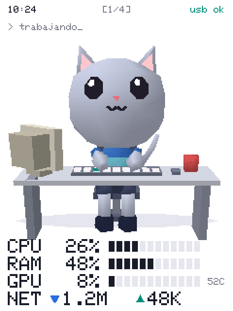

# Mascota ESP32

**A low poly, PlayStation 1 style desktop pet that works when you work.**

It lives on a 2.8" ESP32 touchscreen connected over USB and shows you how your PC is doing at a glance.

*"Mascota" is Spanish for "pet". The on-device interface and code comments are in Spanish.*

[](LICENSE)
[](#what-you-need)
[](firmware)
[](monitor)

[**Download**](https://github.com/AlPeFe/mascota-esp32/releases/latest) · [Install](#install) · [How it works](#how-it-works) · [Español](README.md)

</div>

---

## Features

- 🐱 **Works when you work.** Use your keyboard or mouse and it types. Stop and it has a coffee. Leave and it falls asleep.
- 🕹️ **Custom PSX-style 3D engine.** No depth buffer, wobbly vertices and dithering, at about 18 frames per second on an ESP32.
- 📊 **Resource monitor.** Per-core CPU, RAM, GPU, VRAM, temperature, disk and network, in a clean console style.
- 👆 **Touch.** Pet it and hearts appear. Swipe to change screens.
- 🔄 **Portrait or landscape.** Pick one in Settings and the interface rearranges itself.
- 🪶 **Lightweight tray monitor.** A single Rust executable you can switch off in two clicks.

## Moods

<table>
  <tr>
    <td align="center"><br><b>Working</b><br><sub>You're using the PC</sub></td>
    <td align="center">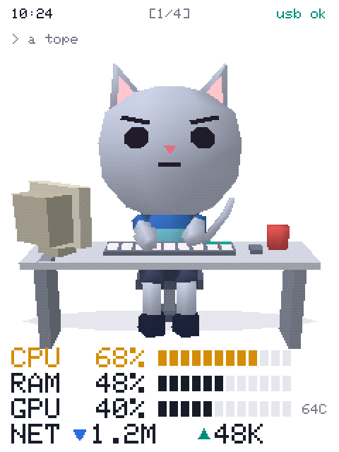<br><b>Flat out</b><br><sub>You're working and the PC is at 55–85%</sub></td>
    <td align="center">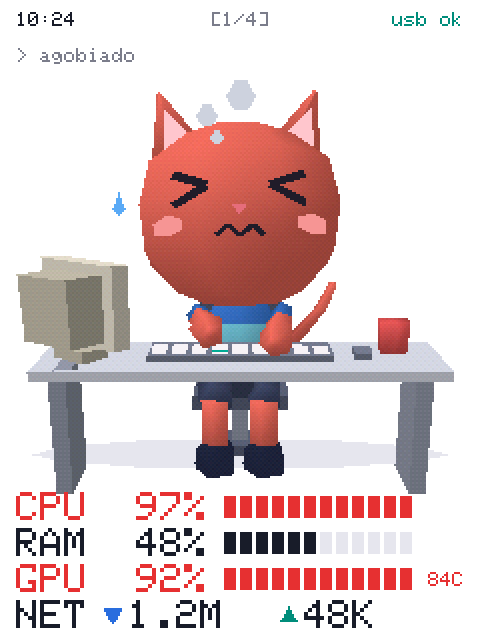<br><b>Stressed</b><br><sub>PC above 85%</sub></td>
  </tr>
  <tr>
    <td align="center">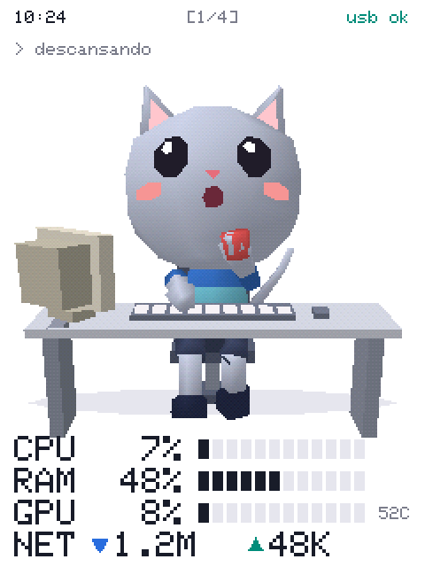<br><b>Resting</b><br><sub>45 s without input</sub></td>
    <td align="center">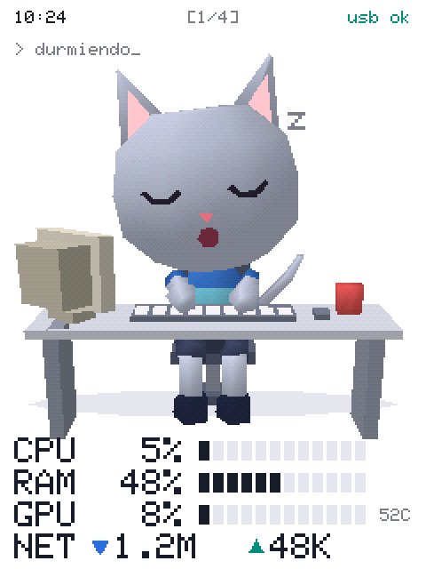<br><b>Sleeping</b><br><sub>10 min without input, or no connection</sub></td>
    <td align="center">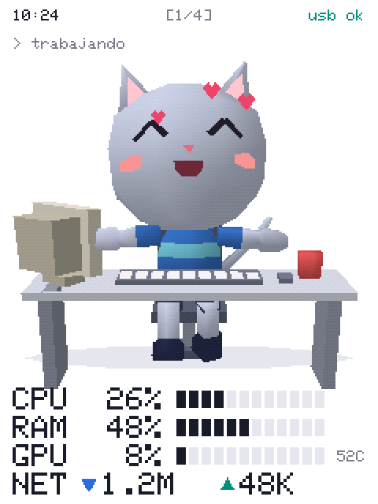<br><b>Cuddles</b><br><sub>When you touch it</sub></td>
  </tr>
</table>

## Screens

<table>
  <tr>
    <td align="center">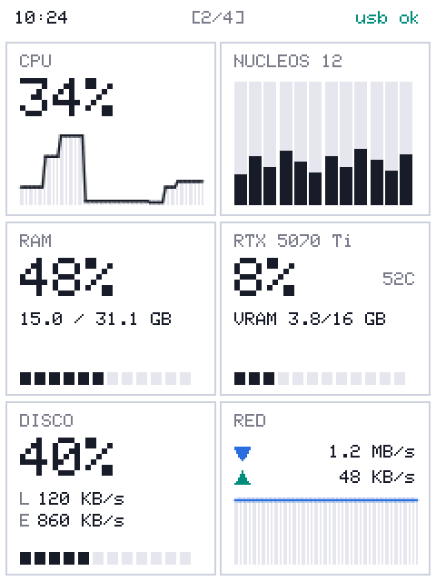<br><b>Resources</b></td>
    <td align="center">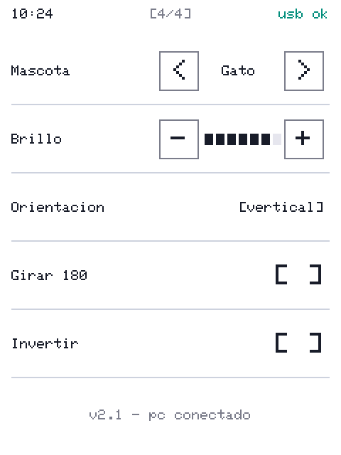<br><b>Settings</b></td>
    <td align="center">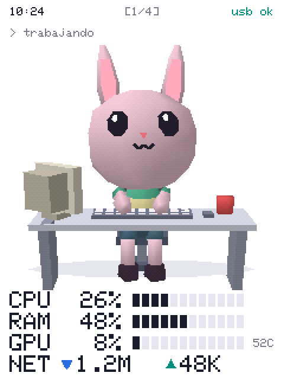<br><b>There's a bunny too</b></td>
  </tr>
</table>

<div align="center">
  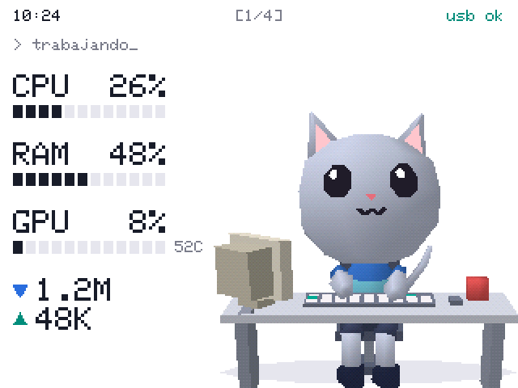
  <br><sub>Landscape works too</sub>
</div>

## What you need

- An **ESP32-2432S028** board with a 2.8" touchscreen (240×320), known as the *Cheap Yellow Display*. Several brands sell it, such as Diymore.
- A USB cable that carries data.
- A Windows PC. With an NVIDIA graphics card you also get GPU data.

## Install

### 1. Flash the firmware

Download `mascota-cyd.bin` from [Releases](https://github.com/AlPeFe/mascota-esp32/releases/latest) and write it with [esptool](https://docs.espressif.com/projects/esptool/). Replace `COM3` with your port:

```bash
pip install esptool
```

```bash
esptool --port COM3 --baud 921600 write_flash 0x0 mascota-cyd.bin
```

A color test appears briefly at startup:

- **Black background or negative colors:** touch the screen to invert them.
- **The red box (ROJO) looks blue, or the image is corrupted:** your board has a different display chip. Try `mascota-cyd2usb.bin`. This variant compiles but hasn't been tested on a real board yet.

> If no COM port appears, install the driver for the board's USB chip, usually a **CH340**.

### 2. Start the monitor on your PC

Download and run `mascota-monitor.exe`. A small cat head appears in the system tray and it finds the board by itself. It doesn't open any window.

| Tray menu (in Spanish) | What it does |
|---|---|
| **Status** | *Conectado* (orange), *Buscando* (yellow) or *Apagado* (gray) |
| **Monitor encendido** | Untick it to stop reading resources and release the USB port |
| **Arrancar con el sistema** | Start with the PC. Keep the program in a permanent folder first |
| **Salir** | Quit completely |

Measured usage on Windows:

| State | CPU | Memory |
|---|---|---|
| On | 0.03% | 39 MB |
| Off | 0% | 11 MB |

> **Privacy:** to know whether you're working, the monitor only sends how many seconds have passed since your last keyboard or mouse input. It never reads what you press, and the data only travels over the USB cable, not the internet.

## How it works

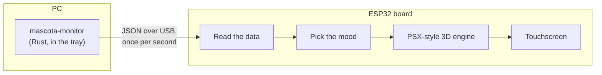

**The 3D engine.** A full screen buffer doesn't fit in a single block of ESP32 RAM, so the image is drawn in horizontal strips. To get the PlayStation 1 look:

- Triangles are sorted back to front, with no depth buffer.
- Vertices are rounded to whole pixels, which causes the wobble when things move.
- Shading is Gouraud, with the console's 4×4 dithering matrix.

## Build from source

**Firmware** (C++ with [PlatformIO](https://platformio.org/)):

```bash
cd firmware
```

```bash
pio run -e cyd -t upload
```

Use `-e cyd2usb` for the other display variant. On Windows, keep the project in a short path such as `C:\mascota-esp32`: very long paths make the build fail with errors like `TFT_eSPI.h: No such file or directory`.

**Monitor** (requires [Rust](https://rustup.rs/)):

```bash
cd monitor
```

```bash
cargo build --release
```

> Switch the monitor off before flashing, because it holds the USB port.

<details>
<summary><b>Linux (experimental)</b></summary>

The code is prepared for Linux, but **it hasn't been compiled or tested there yet**. Help is welcome. There's no activity data there either: the pet works when the PC goes above 20% usage.

On Debian or Ubuntu it needs these libraries:

```bash
sudo apt install libgtk-3-dev libayatana-appindicator3-dev libxdo-dev libudev-dev pkg-config
```

And permission to use the serial port (log out afterwards):

```bash
sudo usermod -aG dialout $USER
```

</details>

## Customize

**A new pet.** Add a species in [`pets.cpp`](firmware/src/pets/pets.cpp) with its ear and tail type, size and colors. It will appear under *Ajustes → Mascota*:

```cpp
static const Critter::Species CAT = {
    false, true, 1.0f,  // long ears, long tail, size
    {205, 212, 232}, {248, 196, 205}, {60, 118, 205}, {120, 205, 225}, {70, 78, 110}, {52, 58, 96},
    // fur, inner ears, shirt, stripe, shorts, shoes
};
```

**Other shapes.** Add parts in `buildBody()` or `buildDesk()` in [`critter.cpp`](firmware/src/pets/critter.cpp), or create another class that inherits from `Pet`.

**Touch calibration.** If touches don't line up with your finger, adjust `TOUCH_X_MIN/MAX` and `TOUCH_Y_MIN/MAX` in [`config.h`](firmware/src/config.h).

**Screenshots.** [`herramientas/captura.py`](herramientas/captura.py) saves what the board is drawing as a PNG, no camera needed. The images on this page were made that way.

<details>
<summary><b>USB protocol</b></summary>

The PC sends one JSON line per second at 115200 baud:

```json
{"t":"res","cpu":41.2,"cores":[27,24,84],"ram":58.7,"ramU":18.3,"ramT":31.1,
 "gpu":10,"vram":22.0,"vramU":3.5,"vramT":15.9,"gpuN":"RTX 5070 Ti","gpuT":50,
 "disk":37.6,"dr":3,"dw":5257,"up":3,"dn":1,"hh":10,"mm":24,"idle":2}
```

- **Units:** rates (`dr`, `dw`, `up`, `dn`) are in KB/s, memory in GB and `idle` in seconds.
- **Greeting:** if the PC sends `?`, the board replies `MASCOTA_ESP32 <version>`.
- **Debugging:** `!info` returns the board's state; `!shot`, `!page N` and `!tap X Y` are used by `captura.py`.

</details>

## Project layout

```
firmware/       Board program (C++ / Arduino)
  src/pets/       Pets and 3D engine
  src/screens/    Interface pages
monitor/        PC program (Rust)
herramientas/   USB screenshot tool
docs/           Images on this page
```

## Roadmap

- [ ] **Tokens** page: AI tool usage. It's already reserved in the interface.
- [ ] Test and polish **Linux** support.
- [ ] Test the `cyd2usb` display variant on a real board.
- [ ] More pets.

## License

[MIT](LICENSE). Use it, change it and share it however you like.
