<div align="center">

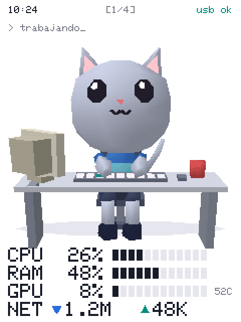

# Mascota ESP32

**Una mascota de escritorio low poly, al estilo PlayStation 1, que trabaja cuando tú trabajas.**

Vive en una pantalla táctil ESP32 de 2,8" conectada por USB y te enseña de un vistazo cómo va tu PC.

[](LICENSE)
[](#qué-necesitas)
[](firmware)
[](monitor)

[**Descargar**](https://github.com/AlPeFe/mascota-esp32/releases/latest) · [Instalación](#instalación) · [Cómo funciona](#cómo-funciona) · [English](README.en.md)

</div>

---

## Qué hace

- 🐱 **Trabaja cuando tú trabajas.** Si usas el teclado o el ratón, teclea. Si paras, se toma un café. Si te vas, se duerme.
- 🕹️ **Motor 3D propio al estilo PSX.** Sin búfer de profundidad, con vértices que tiemblan y dithering, a unas 18 imágenes por segundo en un ESP32.
- 📊 **Monitor de recursos.** CPU por núcleos, RAM, GPU, VRAM, temperatura, disco y red, en un estilo limpio de consola.
- 👆 **Táctil.** Acaríciala y saldrán corazones. Desliza el dedo para cambiar de pantalla.
- 🔄 **Vertical u horizontal.** Se elige en Ajustes y la interfaz se reorganiza sola.
- 🪶 **Monitor ligero en la bandeja.** Un solo ejecutable de Rust que puedes apagar con dos clics.

## Humores

<table>
  <tr>
    <td align="center"><br><b>Trabajando</b><br><sub>Estás usando el PC</sub></td>
    <td align="center">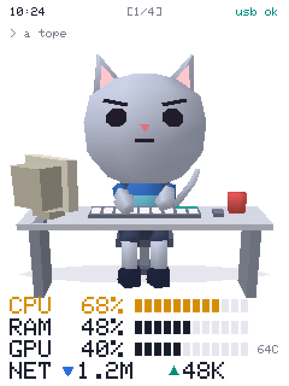<br><b>A tope</b><br><sub>Trabajas y el PC va al 55–85 %</sub></td>
    <td align="center">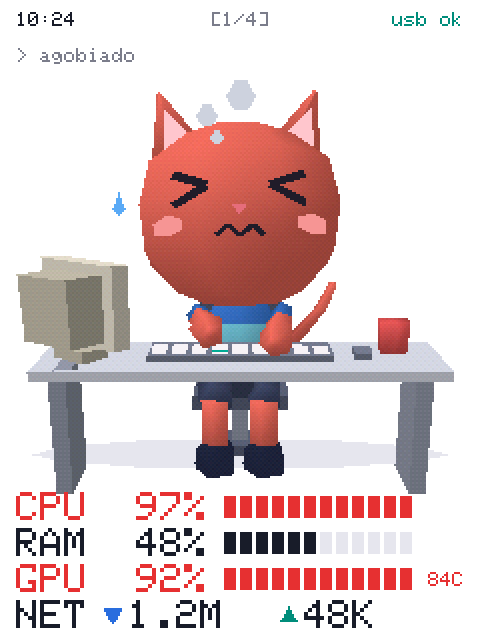<br><b>Agobiado</b><br><sub>PC por encima del 85 %</sub></td>
  </tr>
  <tr>
    <td align="center">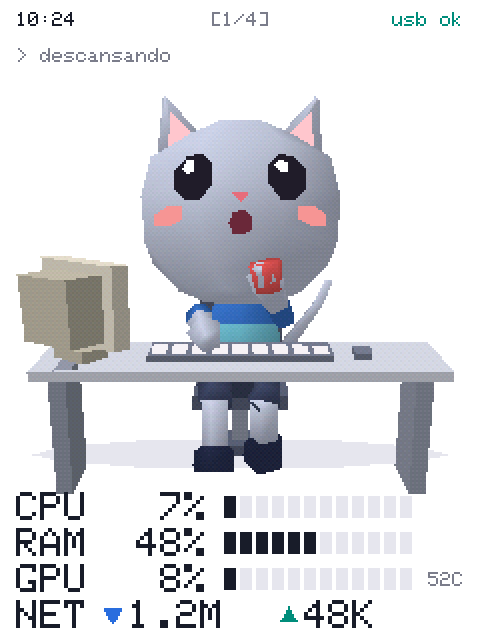<br><b>Descansando</b><br><sub>45 s sin tocar nada</sub></td>
    <td align="center">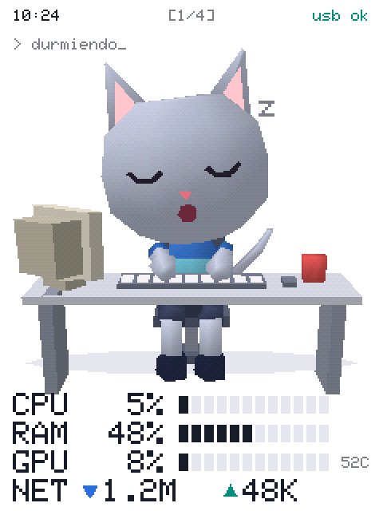<br><b>Durmiendo</b><br><sub>10 min sin tocar nada o sin conexión</sub></td>
    <td align="center">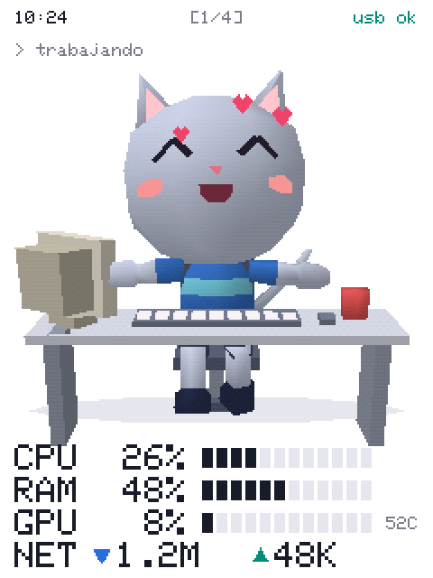<br><b>Mimos</b><br><sub>Cuando la tocas</sub></td>
  </tr>
</table>

## Pantallas

<table>
  <tr>
    <td align="center">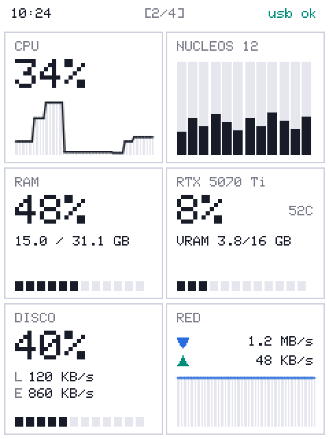<br><b>Recursos</b></td>
    <td align="center">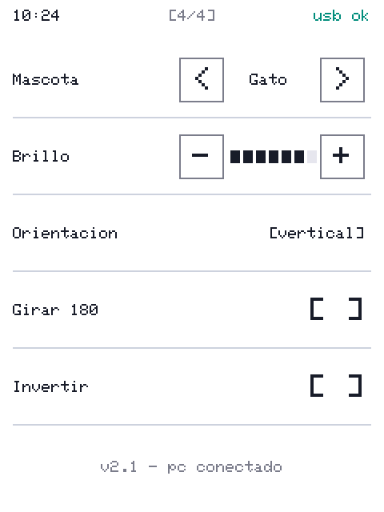<br><b>Ajustes</b></td>
    <td align="center">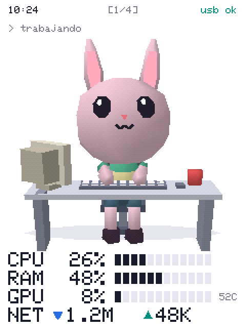<br><b>También hay conejo</b></td>
  </tr>
</table>

<div align="center">
  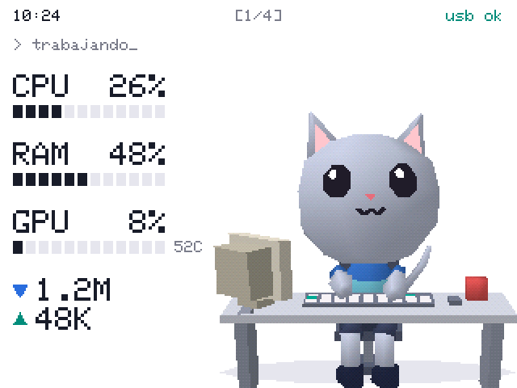
  <br><sub>También en horizontal</sub>
</div>

## Qué necesitas

- Una placa **ESP32-2432S028** con pantalla táctil de 2,8" (240×320), conocida como *Cheap Yellow Display*. La venden varias marcas, como Diymore.
- Un cable USB que transmita datos.
- Un PC con Windows. Con una gráfica NVIDIA verás también los datos de GPU.

## Instalación

### 1. Carga el firmware en la placa

Descarga `mascota-cyd.bin` desde [Releases](https://github.com/AlPeFe/mascota-esp32/releases/latest) y grábalo con [esptool](https://docs.espressif.com/projects/esptool/). Cambia `COM3` por tu puerto:

```bash
pip install esptool
```

```bash
esptool --port COM3 --baud 921600 write_flash 0x0 mascota-cyd.bin
```

Al arrancar sale un momento una prueba de colores:

- **Fondo negro o colores en negativo:** toca la pantalla para invertirlos.
- **El cuadro ROJO sale azul o la imagen sale corrupta:** tu placa lleva otro chip de pantalla. Prueba `mascota-cyd2usb.bin`. Esta variante compila, pero aún no se ha probado en una placa real.

> Si no aparece el puerto COM, instala el driver del chip USB de la placa, normalmente un **CH340**.

### 2. Arranca el monitor en el PC

Descarga y ejecuta `mascota-monitor.exe`. Aparecerá una cabecita de gato en la bandeja del sistema y encontrará la placa solo. No abre ninguna ventana.

| Menú del icono | Qué hace |
|---|---|
| **Estado** | *Conectado* (naranja), *Buscando* (amarillo) o *Apagado* (gris) |
| **Monitor encendido** | Al desactivarlo deja de leer recursos y suelta el USB |
| **Arrancar con el sistema** | Se abre al encender el PC. Antes, deja el programa en una carpeta fija |
| **Salir** | Lo cierra del todo |

Consumo medido en Windows:

| Estado | CPU | Memoria |
|---|---|---|
| Encendido | 0,03 % | 39 MB |
| Apagado | 0 % | 11 MB |

> **Privacidad:** para saber si trabajas, el monitor envía solo los segundos que llevas sin tocar teclado ni ratón. Nunca lee lo que pulsas, y los datos solo viajan por el cable USB, sin pasar por internet.

## Cómo funciona

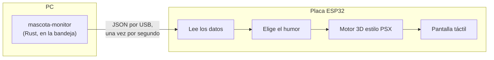

**El motor 3D.** Un búfer de pantalla completo no cabe en un solo bloque de RAM del ESP32, así que la imagen se dibuja por franjas horizontales. Para conseguir el aire de PlayStation 1:

- Los triángulos se ordenan de atrás adelante, sin búfer de profundidad.
- Los vértices se redondean a píxeles enteros, de ahí el temblor al moverse.
- El sombreado es Gouraud, con la matriz de dithering de 4×4 de la consola.

## Compilar desde el código

**Firmware** (C++ con [PlatformIO](https://platformio.org/)):

```bash
cd firmware
```

```bash
pio run -e cyd -t upload
```

Usa `-e cyd2usb` para la otra variante de pantalla. En Windows, deja el proyecto en una ruta corta como `C:\mascota-esp32`: con rutas muy largas la compilación falla con errores como `TFT_eSPI.h: No such file or directory`.

**Monitor** (necesita [Rust](https://rustup.rs/)):

```bash
cd monitor
```

```bash
cargo build --release
```

> Apaga el monitor antes de cargar el firmware, porque ocupa el puerto USB.

<details>
<summary><b>Linux (experimental)</b></summary>

El código está preparado para Linux, pero **aún no se ha compilado ni probado allí**. Toda ayuda es bienvenida. Allí tampoco hay dato de actividad: la mascota trabaja cuando el PC supera el 20 % de uso.

En Debian o Ubuntu necesita estas librerías:

```bash
sudo apt install libgtk-3-dev libayatana-appindicator3-dev libxdo-dev libudev-dev pkg-config
```

Y permiso para usar el puerto serie (cierra sesión después):

```bash
sudo usermod -aG dialout $USER
```

</details>

## Personalizar

**Una mascota nueva.** Añade una especie en [`pets.cpp`](firmware/src/pets/pets.cpp) con su tipo de orejas y cola, su tamaño y sus colores. Aparecerá en *Ajustes → Mascota*:

```cpp
static const Critter::Species CAT = {
    false, true, 1.0f,  // orejas largas, cola larga, tamaño
    {205, 212, 232}, {248, 196, 205}, {60, 118, 205}, {120, 205, 225}, {70, 78, 110}, {52, 58, 96},
    // pelo, interior de orejas, camiseta, raya, pantalón, zapatos
};
```

**Otras formas.** Añade piezas en `buildBody()` o `buildDesk()` de [`critter.cpp`](firmware/src/pets/critter.cpp), o crea otra clase que herede de `Pet`.

**Calibrar el táctil.** Si el toque no coincide con el dedo, ajusta `TOUCH_X_MIN/MAX` y `TOUCH_Y_MIN/MAX` en [`config.h`](firmware/src/config.h).

**Capturas de pantalla.** [`herramientas/captura.py`](herramientas/captura.py) guarda en PNG lo que dibuja la placa, sin hacerle fotos. Así se hicieron las imágenes de esta página.

<details>
<summary><b>Protocolo USB</b></summary>

El PC envía una línea JSON por segundo a 115200 baudios:

```json
{"t":"res","cpu":41.2,"cores":[27,24,84],"ram":58.7,"ramU":18.3,"ramT":31.1,
 "gpu":10,"vram":22.0,"vramU":3.5,"vramT":15.9,"gpuN":"RTX 5070 Ti","gpuT":50,
 "disk":37.6,"dr":3,"dw":5257,"up":3,"dn":1,"hh":10,"mm":24,"idle":2}
```

- **Unidades:** las velocidades (`dr`, `dw`, `up`, `dn`) van en KB/s, las memorias en GB e `idle` en segundos.
- **Saludo:** si el PC envía `?`, la placa responde `MASCOTA_ESP32 <versión>`.
- **Depuración:** `!info` devuelve el estado de la placa; `!shot`, `!page N` y `!tap X Y` son los que usa `captura.py`.

</details>

## Estructura

```
firmware/       Programa de la placa (C++ / Arduino)
  src/pets/       Mascotas y motor 3D
  src/screens/    Páginas de la interfaz
monitor/        Programa del PC (Rust)
herramientas/   Capturas de pantalla por USB
docs/           Imágenes de esta página
```

## Próximamente

- [ ] Página de **tokens**: consumo de herramientas de IA. Ya está reservada en la interfaz.
- [ ] Probar y pulir el soporte de **Linux**.
- [ ] Probar la variante de pantalla `cyd2usb` en una placa real.
- [ ] Más mascotas.

## Licencia

[MIT](LICENSE). Úsalo, modifícalo y compártelo como quieras.
